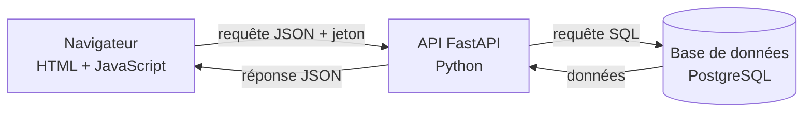
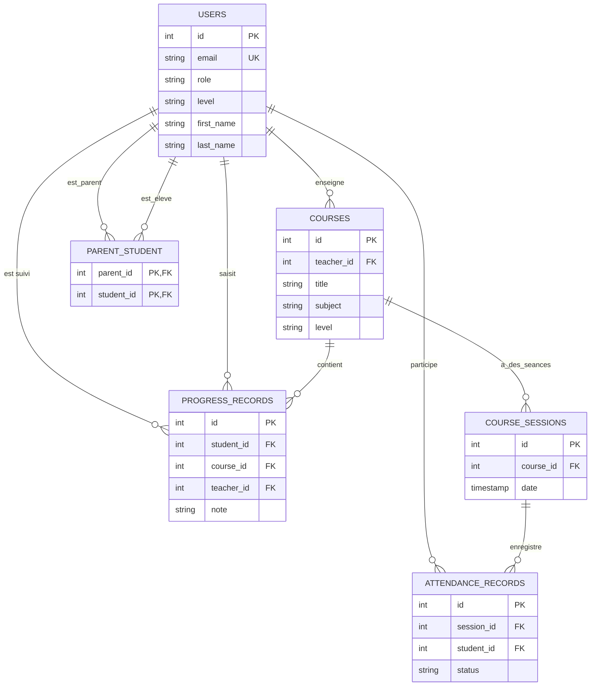

# 🎓 Classe Accès

🌐 Plateforme de cours à distance pour une association scolaire (environ 100 élèves et 10 professeurs).

🔗 [Dépôt GitHub](https://github.com/madi-spec49/Classe_Acces)

## 🌱 Présentation

Le staff crée les comptes et les cours. Les professeurs saisissent la présence et la progression. Les élèves et leurs parents consultent le suivi.

Projet réalisé dans le cadre du **Portfolio Stage 4** (Holberton School).

## ⚙️ Fonctionnalités

- 👤 **Comptes** : créés par le staff, sans inscription publique
- 📚 **Cours** : un niveau par cours (débutant, intermédiaire, avancé)
- ✅ **Présences** : présent, absent ou en retard
- 📈 **Progression** : niveau atteint et note par élève
- 👪 **Suivi parent** : un parent voit uniquement ses enfants
- 🔐 **Connexion** : JWT valable 60 minutes

## 🏗️ Architecture



## 🗄️ Base de données



Le détail de la base de données, des droits d'accès et des routes est dans [`docs/6. Documentation Technique Finale.md`](docs/6.%20Documentation%20Technique%20Finale.md).

## 🧰 Stack technique

- **Back-end** : FastAPI, SQLAlchemy, Pydantic
- **Base de données** : PostgreSQL (Docker)
- **Front-end** : HTML et JavaScript natif
- **Tests** : pytest

## 🚀 Installation

```bash
git clone https://github.com/madi-spec49/Classe_Acces.git
cd Classe_Acces
python3 -m venv venv && source venv/bin/activate
pip install -r requirements.txt
docker compose up -d db
uvicorn app.main:app --reload
```

Puis lancer le front-end depuis le dossier `frontend/` :

```bash
cd frontend
python3 -m http.server 5500
```

Page de connexion : http://127.0.0.1:5500/login.html

> Ce lien ne fonctionne que sur la machine où tourne le serveur. L'API doit aussi tourner (`uvicorn app.main:app --reload`).

Les variables d'environnement, l'arborescence et la liste des routes sont dans l'[annexe de la documentation technique](docs/6.%20Documentation%20Technique%20Finale.md#annexes-installation-routes-et-organisation).

## 🧪 Tests

```bash
python -m pytest -v
```

## 👨‍💻 Auteur

Madi Anli, étudiant à Holberton School Laval.
