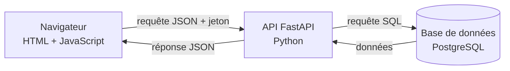

# Classe Accès — Documentation technique (Portfolio, Stage 4)

Plateforme de cours à distance pour une association scolaire

Ce document fait partie de la documentation technique de **Classe Accès**. Le MVP s'appuie sur une stack FastAPI + SQLAlchemy + PostgreSQL + JWT, avec une interface HTML/JavaScript native.

## 2. Architecture système

### 2.1 Vue d'ensemble

L'architecture repose sur une séparation en trois couches : un client léger (navigateur), une API REST (FastAPI) et une base de données relationnelle (PostgreSQL), accessible uniquement par l'ORM SQLAlchemy. Aucun service externe n'est utilisé dans le MVP.

### 2.2 Composants

| # | Composant | Technologie | Rôle |
| --- | --- | --- | --- |
| 1 | Navigateur | HTML + JavaScript natif | Envoie des requêtes HTTP/JSON à l'API, avec le jeton JWT dans l'en-tête `Authorization` sur les routes protégées |
| 2 | Back-end | FastAPI (Python 3.12) | Routes REST, validation des données (Pydantic), authentification JWT, contrôle des rôles |
| 3 | Accès aux données | SQLAlchemy 2.0 | Modèles Python qui décrivent les tables, requêtes sans SQL brut |
| 4 | Base de données | PostgreSQL 16 (Docker) | Stockage persistant, contraintes et clés étrangères |

#### 2.2.1 Navigateur (HTML + JavaScript natif)

L'interface est un ensemble de six pages HTML servies séparément de l'API (`python3 -m http.server 5500`), sans framework ni étape de build. Après la connexion, le jeton JWT et le rôle sont conservés dans le `localStorage` du navigateur. Chaque page appelle l'API avec `fetch`, ajoute l'en-tête `Authorization: Bearer <token>`, et renvoie vers `login.html` si l'API répond `401`.

Le rôle stocké dans le navigateur ne sert qu'à choisir la page d'accueil. **La vraie vérification des droits est toujours faite côté API.**

#### 2.2.2 Back-end FastAPI

Le back-end expose une API REST sous le préfixe `/api`, organisée en sept domaines, un fichier par domaine dans `app/routes/` :

- `auth` : connexion et profil de l'utilisateur courant.
- `staff` : création de professeurs et d'élèves, listes, réinitialisation de mot de passe, suppression de comptes.
- `parents` : création de comptes parents, liaison à un élève, liste de ses enfants.
- `courses` : cours, séances, liste des élèves d'un cours.
- `attendance` : assiduité d'une séance.
- `progress` : progression des élèves.
- `suivi` : assiduité d'un élève, consultée par l'élève, son parent ou le staff.

La sécurité repose sur deux dépendances définies dans `app/dependencies.py` :

- `get_current_user` décode le jeton JWT, charge l'utilisateur en base et vérifie qu'il est actif.
- `require_role(...)` refuse l'accès avec un `403` si le rôle ne correspond pas.

Les règles de propriété (le cours du professeur, l'enfant du parent, le niveau de l'élève) sont vérifiées dans chaque route. Les mots de passe sont hachés avec **bcrypt**.

#### 2.2.3 Base de données PostgreSQL et SQLAlchemy

La base est lancée avec Docker Compose (`docker compose up -d db`). Le schéma de référence est `db/schema.sql`, et les modèles SQLAlchemy de `app/models/` créent les mêmes tables avec `create_all`. Les contraintes (`CHECK`, clés étrangères, unicité) sont déclarées en base, afin que les règles s'appliquent même si le code évolue.

Pour les tests, l'application utilise une base **SQLite en mémoire**, grâce à l'ORM qui génère le SQL adapté à chaque base.

#### 2.2.4 Conteneurisation

Docker Compose ne lance que la base PostgreSQL. L'API et le front-end tournent directement sur le poste de développement (`uvicorn` et `http.server`). Conteneuriser l'API est une évolution prévue (voir `7. Roadmap Phase Future.md`).

### 2.3 Flux de données

1. Le navigateur envoie une requête HTTP/JSON à l'API, avec le jeton JWT dans l'en-tête `Authorization` sur les routes protégées.
2. `get_current_user` valide le jeton et recharge l'utilisateur en base à chaque requête : un compte supprimé ou désactivé perd son accès immédiatement.
3. `require_role` contrôle le rôle, puis la route applique les règles de propriété (par exemple, un parent n'accède qu'aux données de ses enfants).
4. La route interroge ou modifie la base avec SQLAlchemy.
5. Un schéma Pydantic de réponse sélectionne les champs renvoyés (le hash du mot de passe n'est jamais exposé).

### 2.4 Décisions d'architecture

| Décision | Justification |
| --- | --- |
| HTML et JavaScript natif, sans framework | Aucun outil de build, simple à expliquer et à maintenir pour un MVP |
| FastAPI + Pydantic | Validation automatique, documentation OpenAPI générée sur `/docs`, code lisible |
| JWT + bcrypt | Authentification sans session côté serveur ; hachage lent et salé des mots de passe |
| `require_role` sous forme de dépendance | Contrôle d'accès centralisé, appliqué route par route |
| Règles de propriété dans les routes | Un rôle correct ne suffit pas : un professeur ne saisit l'assiduité que dans ses propres cours |
| SQLAlchemy ORM | Pas de SQL concaténé (protection contre l'injection SQL), mêmes modèles pour PostgreSQL et SQLite |
| PostgreSQL | Base relationnelle stricte, adaptée à la production |
| Contraintes en base | La base refuse les données invalides même si le code change |
| Comptes créés uniquement par le staff | Pas d'inscription publique : aucune élévation de privilège possible par ce biais |

### 2.5 Évolutions prévues (hors MVP)

Voir `7. Roadmap Phase Future.md` : migrations Alembic, chargement automatique du `.env`, conteneurisation de l'API, intégration continue, signalements d'absence, messagerie, paiement HelloAsso.
