# Classe Accès — Documentation technique (Portfolio, Stage 4)

Plateforme de cours à distance pour une association scolaire

Ce document fait partie de la documentation technique de **Classe Accès**. Le MVP s'appuie sur une stack FastAPI + SQLAlchemy + PostgreSQL + JWT, avec une interface HTML/JavaScript native.

## 3. Composants, classes et conception de la base de données

### 3.1 Classes principales (back-end — SQLAlchemy)

Chaque classe de `app/models/` décrit une table. Ce sont des classes de **données** : elles ne portent pas de méthodes métier. La logique (contrôle d'accès, règles de propriété) est dans les routes et dans `app/dependencies.py`.

| Classe | Fichier | Champs | Rôle |
| --- | --- | --- | --- |
| `User` | `user.py` | id, email, password_hash, role (`student`, `parent`, `teacher`, `staff`), level, first_name, last_name, is_active, created_at | Compte unique pour les quatre rôles ; `level` n'est renseigné que pour les élèves |
| `ParentStudent` | `parent_student.py` | parent_id, student_id | Table d'association parent ↔ élève |
| `Course` | `course.py` | id, teacher_id, title, subject, day_of_week, start_time, end_time, zoom_link, level | Cours hebdomadaire d'un niveau donné, rattaché à un professeur |
| `CourseSession` | `course.py` | id, course_id, date, zoom_link | Séance datée d'un cours, qui porte l'assiduité |
| `AttendanceRecord` | `attendance.py` | id, session_id, student_id, status (`present`, `absent`, `late`), note, created_at | Assiduité d'un élève à une séance |
| `ProgressRecord` | `progress.py` | id, student_id, course_id, teacher_id, level, note, date | Progression d'un élève dans un cours |

Les schémas Pydantic de `app/schemas/` sont d'autres classes : ils décrivent les données **échangées** avec le client (entrée : `StudentCreate`, `CourseCreate`, `AttendanceCreate`, `ProgressCreate` ; sortie : `UserResponse`, `CourseResponse`, `AttendanceResponse`, `ProgressResponse`). Les modèles décrivent la base, les schémas décrivent l'API : `UserResponse` n'expose jamais `password_hash`.

### 3.2 Relations principales (ERD)

```mermaid
erDiagram
    USERS ||--o{ COURSES : enseigne
    USERS ||--o{ ATTENDANCE_RECORDS : participe
    USERS ||--o{ PROGRESS_RECORDS : "est suivi"
    USERS ||--o{ PROGRESS_RECORDS : saisit
    USERS ||--o{ PARENT_STUDENT : est_parent
    USERS ||--o{ PARENT_STUDENT : est_eleve
    COURSES ||--o{ COURSE_SESSIONS : a_des_seances
    COURSE_SESSIONS ||--o{ ATTENDANCE_RECORDS : enregistre
    COURSES ||--o{ PROGRESS_RECORDS : contient

    USERS {
        int id PK
        string email UK
        string role
        string level
        string first_name
        string last_name
    }
    COURSES {
        int id PK
        int teacher_id FK
        string title
        string subject
        string level
    }
    COURSE_SESSIONS {
        int id PK
        int course_id FK
        timestamp date
    }
    ATTENDANCE_RECORDS {
        int id PK
        int session_id FK
        int student_id FK
        string status
    }
    PROGRESS_RECORDS {
        int id PK
        int student_id FK
        int course_id FK
        int teacher_id FK
        string note
    }
    PARENT_STUDENT {
        int parent_id PK, FK
        int student_id PK, FK
    }
```

| Relation | Cardinalité | Description |
| --- | --- | --- |
| `USERS` — `COURSES` | 1 — N | Un professeur enseigne plusieurs cours |
| `COURSES` — `COURSE_SESSIONS` | 1 — N | Un cours a plusieurs séances datées |
| `COURSE_SESSIONS` — `ATTENDANCE_RECORDS` | 1 — N | Une séance reçoit plusieurs relevés de présence |
| `USERS` — `ATTENDANCE_RECORDS` | 1 — N | Un élève a des présences sur plusieurs séances |
| `USERS` — `PROGRESS_RECORDS` | 1 — N | Un élève a plusieurs progressions ; un professeur en saisit plusieurs |
| `COURSES` — `PROGRESS_RECORDS` | 1 — N | Une progression concerne un seul cours |
| `USERS` — `PARENT_STUDENT` | N — N | Un parent a plusieurs enfants, un enfant peut avoir plusieurs parents |

### 3.3 Détail des tables

Le schéma SQL de référence est `db/schema.sql`.

| Table | Contraintes et notes |
| --- | --- |
| `users` | `email` unique ; `CHECK` sur `role` et sur `level` (`debutant`, `intermediaire`, `avance`) ; `level` nul pour les non-élèves |
| `parent_student` | Clé primaire composite (`parent_id`, `student_id`) ; `CHECK (parent_id <> student_id)` ; suppression en `CASCADE` |
| `courses` | `teacher_id` en `RESTRICT` ; `CHECK` sur le jour (0 à 6), sur l'ordre des horaires (`end_time > start_time`) et sur le niveau |
| `course_sessions` | `course_id` en `CASCADE` ; `zoom_link` facultatif |
| `attendance_records` | `session_id` et `student_id` en `CASCADE` ; `CHECK` sur le statut ; `UNIQUE (session_id, student_id)` |
| `progress_records` | `student_id` et `course_id` en `CASCADE`, `teacher_id` en `RESTRICT` ; `level` est un texte libre |

### 3.4 Front-end (composants et interactions)

Chaque page a sa propre fonction `appel` qui ajoute l'en-tête `Authorization` et renvoie vers `login.html` sur une réponse `401`.

| Page | Rôle | Routes appelées |
| --- | --- | --- |
| `login.html` | Connexion, puis redirection selon le rôle | `POST /api/auth/login` |
| `staff.html` | Gestion des comptes, des liens parent-élève et des cours | `GET/POST /api/staff/teachers`, `GET/POST /api/staff/students`, `GET /api/staff/users`, `POST /api/staff/users/{id}/password`, `DELETE /api/staff/users/{id}`, `POST /api/parents`, `POST /api/parents/{id}/students/{id}`, `GET/POST /api/courses`, `DELETE /api/courses/{id}` |
| `teacher.html` | Séances, assiduité et progression | `GET /api/auth/me`, `GET /api/courses`, `GET/POST /api/courses/{id}/sessions`, `GET /api/courses/{id}/students`, `GET/POST /api/sessions/{id}/attendance`, `POST /api/progress` |
| `courses.html` | Cours de l'élève | `GET /api/auth/me`, `GET /api/courses` |
| `suivi.html` | Suivi d'un élève | `GET /api/auth/me`, `GET /api/students/{id}/attendance`, `GET /api/progress/students/{id}` |
| `parent.html` | Enfants du parent | `GET /api/auth/me`, `GET /api/parents/me/children` |

**Flux d'interaction typique** : après un `POST /api/auth/login` réussi, le jeton et le rôle sont enregistrés dans le `localStorage`, puis la page est choisie selon le rôle (`staff.html`, `teacher.html`, `parent.html`, ou `courses.html` pour un élève). Depuis `parent.html` ou `courses.html`, un lien mène à `suivi.html?id=...`.

### 3.5 Décisions de conception

- **Une seule table `users` pour les quatre rôles** : simple et suffisante pour le MVP. Le compromis est que `level` est nul pour trois rôles sur quatre.
- **`parent_student` en table d'association** : un parent peut avoir plusieurs enfants et un enfant plusieurs parents, sans duplication des données.
- **`course_sessions` séparé de `courses`** : le cours est le modèle récurrent, la séance est l'instance datée qui porte les présences.
- **Unicité `(session_id, student_id)`** : une seule présence par élève et par séance. Un second enregistrement met à jour le premier.
- **Deux « niveaux » distincts** : `users.level` et `courses.level` désignent la classe ; `progress_records.level` désigne le niveau atteint par l'élève (texte libre, par exemple « Niveau 2 »).
- **Suppression en cascade ou restreinte** : supprimer un élève supprime ses présences, sa progression et ses liens (`CASCADE`). Supprimer un professeur encore rattaché à un cours est refusé (`RESTRICT`), pour ne pas perdre l'historique.
- **Contraintes en base** : `CHECK` sur les rôles, les niveaux, les statuts, le jour et l'ordre des horaires, en complément de la validation Pydantic.
- **`zoom_link` sur le cours et sur la séance** : le cours porte le lien habituel, la séance peut en porter un différent pour une séance ponctuelle.
- **Pas de `relationship()` SQLAlchemy** : les jointures sont écrites explicitement dans les routes, et les suppressions en cascade sont assurées par les clés étrangères de la base.
