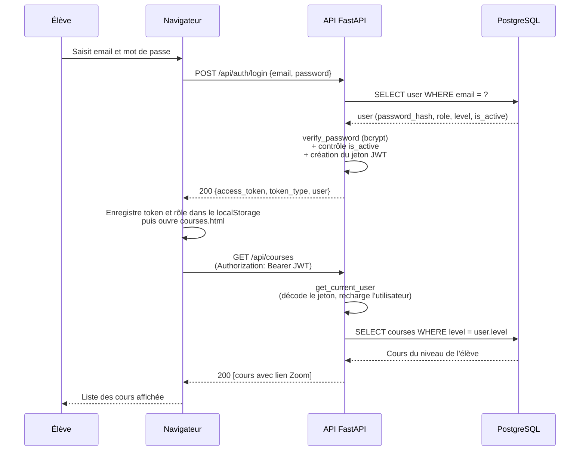
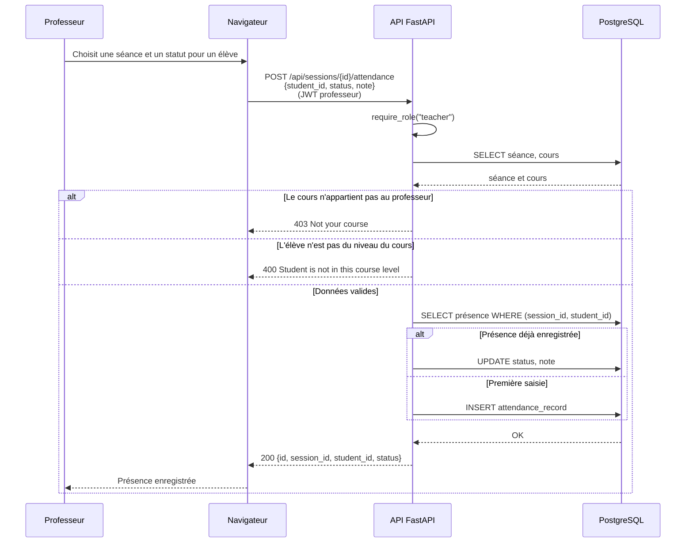
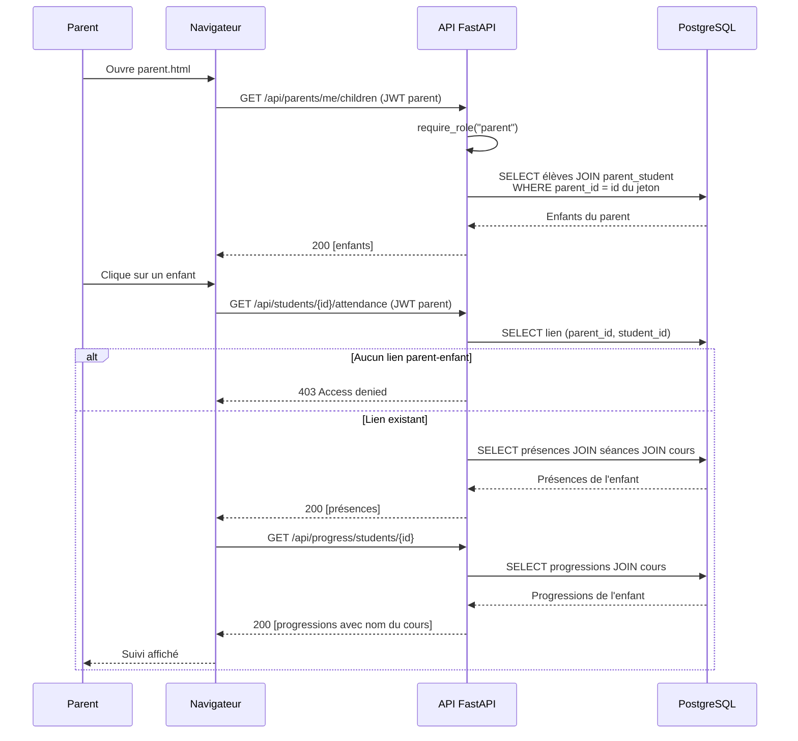

# Classe Accès — Documentation technique (Portfolio, Stage 4)

Plateforme de cours à distance pour une association scolaire

Ce document fait partie de la documentation technique de **Classe Accès**. Le MVP s'appuie sur une stack FastAPI + SQLAlchemy + PostgreSQL + JWT, avec une interface HTML/JavaScript native.

## 4. Diagrammes de séquence (interactions clés)

### 4.1 Vue d'ensemble des cas d'utilisation

Trois cas d'utilisation couvrent les interactions clés entre le navigateur, l'API FastAPI et la base PostgreSQL :

| # | Cas d'utilisation | Acteurs | Entités (section 3) |
| --- | --- | --- | --- |
| 1 | **Connexion JWT → consultation des cours de son niveau** | Élève | `User`, `Course` |
| 2 | **Saisie de l'assiduité par le professeur du cours** | Professeur | `Course`, `CourseSession`, `AttendanceRecord` |
| 3 | **Consultation du suivi d'un enfant par son parent** | Parent | `ParentStudent`, `AttendanceRecord`, `ProgressRecord` |

---

### 4.2 Cas 1 — Connexion JWT → consultation des cours (élève)

L'élève se connecte avec son email et son mot de passe. L'API vérifie le hash **bcrypt**, refuse un compte désactivé, puis crée un jeton JWT. Le jeton sert ensuite sur `GET /api/courses`, qui ne renvoie que les cours du **niveau** de l'élève.

Un mauvais mot de passe ou un email inconnu renvoie le **même** `401`, pour ne pas révéler quels emails existent.

---

### 4.3 Cas 2 — Saisie de l'assiduité par le professeur du cours

Le staff a créé le cours. Le professeur crée une séance, puis enregistre la présence d'un élève. La route contrôle trois choses : le rôle (`teacher`), la propriété (c'est bien son cours) et le niveau de l'élève. Une seconde saisie pour le même élève et la même séance **met à jour** la première.

---

### 4.4 Cas 3 — Consultation du suivi d'un enfant (parent)

Le parent liste ses enfants, puis ouvre le suivi de l'un d'eux. L'API vérifie qu'un lien existe dans `parent_student` avant de renvoyer l'assiduité ou la progression : un parent ne voit jamais les données d'un élève qui n'est pas le sien.

---

### 4.5 Synthèse des interactions

| Cas | Rôles | Écriture | Lecture | Entités |
| --- | --- | --- | --- | --- |
| 1. Connexion → cours | élève | `POST /api/auth/login` | `GET /api/courses` | `User`, `Course` |
| 2. Assiduité | professeur | `POST /api/sessions/{id}/attendance` | `GET /api/sessions/{id}/attendance` | `CourseSession`, `AttendanceRecord` |
| 3. Suivi d'un enfant | parent | — | `GET /api/parents/me/children`, `GET /api/students/{id}/attendance`, `GET /api/progress/students/{id}` | `ParentStudent`, `AttendanceRecord`, `ProgressRecord` |

**Principes communs aux trois diagrammes :**

- Toutes les routes, sauf `POST /api/auth/login` et `GET /health`, exigent un **jeton JWT** dans l'en-tête `Authorization`.
- Le **rôle** est contrôlé par `require_role`, puis les **règles de propriété** sont vérifiées dans la route, avant toute écriture ou lecture sensible.
- `401` signifie « identité inconnue ou jeton invalide », `403` signifie « identité connue mais droit insuffisant ».
- Le navigateur n'accède **jamais directement** à la base : toute interaction passe par l'API.
