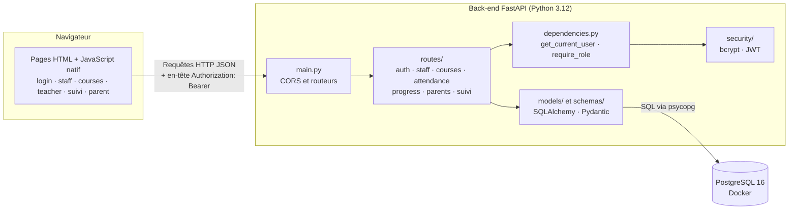
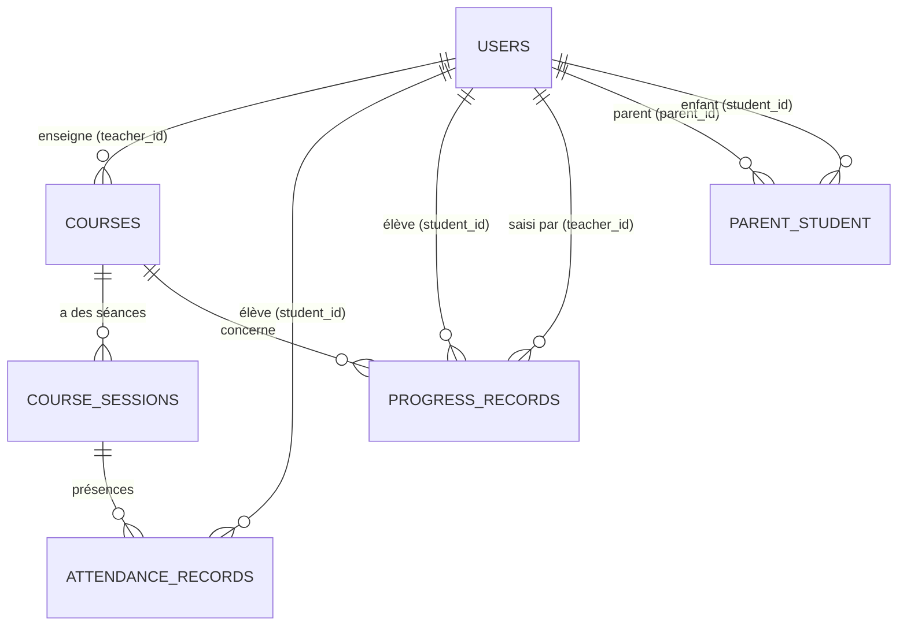

# Classe Accès — Documentation technique finale (Portfolio, Stage 4)

Plateforme de cours à distance pour une association scolaire

Ce document est la synthèse de la documentation technique de **Classe Accès**, une plateforme de cours à distance destinée à une association scolaire. Le MVP permet d'organiser des cours à distance le week-end pour environ 100 élèves et 10 professeurs. La solution s'appuie sur une stack FastAPI + SQLAlchemy + PostgreSQL + JWT, avec une interface HTML/JavaScript native.

Chaque section renvoie au document détaillé correspondant. Pour l'installation et l'usage, voir le `README.md` à la racine du dépôt.

---

## Sommaire

1. [User stories et écrans](#1-user-stories-et-écrans)
2. [Architecture système](#2-architecture-système)
3. [Classes et base de données](#3-classes-et-base-de-données)
4. [Séquences clés](#4-séquences-clés)
5. [API](#5-api)
6. [SCM et QA](#6-scm-et-qa)
7. [Justifications techniques](#7-justifications-techniques)
8. [Limites connues et évolutions](#8-limites-connues-et-évolutions)

---

## 1. User stories et écrans

Détail : `0. User Stories et Maquettes.md`.

Le MVP couvre tous les **Must have** :

- **Staff** : crée les comptes élèves (avec niveau), parents et professeurs, lie un parent à ses enfants, crée et supprime les cours, réinitialise un mot de passe, supprime un compte.
- **Professeur** : crée les séances de ses cours, saisit l'assiduité (présent, absent, en retard) et la progression de chaque élève de son niveau.
- **Élève** : voit les cours de son niveau et son propre suivi (assiduité, progression).
- **Parent** : voit uniquement le suivi de ses enfants, sans accès aux cours.

Six pages HTML : `login`, `staff`, `teacher`, `courses` (élève), `suivi` (élève, parent) et `parent`.

**Reporté après le MVP** : signalements d'absence, messagerie, paiement HelloAsso, notifications, modification d'un cours. **Abandonné pendant le développement** : l'inscription publique et les demandes d'inscription, remplacées par un système de niveaux.

---

## 2. Architecture système

Détail : `1. Architecture Système.md`.

**Trois couches** : un client léger, une API REST et une base relationnelle accessible uniquement par l'ORM.

**Requête protégée** : le navigateur envoie le jeton JWT dans `Authorization`. `get_current_user` le décode, recharge l'utilisateur en base et vérifie qu'il est actif. `require_role` contrôle le rôle, puis la route applique les règles de propriété et renvoie un schéma Pydantic.

**Docker** ne lance que la base PostgreSQL. L'API et le front-end tournent sur le poste de développement.

---

## 3. Classes et base de données

Détail : `2. Composants Classes et BDD.md` ; schéma SQL : `db/schema.sql`.

Six tables : `users` (quatre rôles), `parent_student`, `courses`, `course_sessions`, `attendance_records`, `progress_records`.

**Décisions principales :**

- `parent_student` est une table d'association à clé composite (relation plusieurs-à-plusieurs).
- `course_sessions` est séparé de `courses` : le cours est récurrent, la séance est l'instance datée qui porte les présences.
- `UNIQUE (session_id, student_id)` : une seule présence par élève et par séance.
- `CASCADE` pour effacer l'historique d'un élève ou d'un cours, `RESTRICT` pour protéger un professeur qui a encore des cours.
- `CHECK` en base sur les rôles, les niveaux, les statuts, le jour et l'ordre des horaires.

---

## 4. Séquences clés

Détail : `3. Diagrammes de Séquence.md`.

1. **Connexion → cours de son niveau** (élève) : `POST /api/auth/login`, puis `GET /api/courses` filtré par niveau.
2. **Saisie de l'assiduité** (professeur) : contrôle du rôle, de la propriété du cours et du niveau de l'élève ; une seconde saisie met à jour la première.
3. **Suivi d'un enfant** (parent) : l'API vérifie le lien dans `parent_student` avant de renvoyer l'assiduité et la progression.

---

## 5. API

Détail : `4. Spécifications API.md`.

25 routes sous le préfixe `/api`, plus `/health`. Documentation interactive sur `/docs`.

| Domaine | Routes | Accès |
| --- | --- | --- |
| `auth` | `POST /login`, `GET /me` | public, puis connecté |
| `staff` | création de professeurs et d'élèves, listes, réinitialisation de mot de passe, suppression de comptes | staff |
| `parents` | création, liaison à un élève, `GET /me/children` | staff, puis parent |
| `courses` | création et suppression de cours, liste des élèves d'un cours, séances | selon le rôle |
| `attendance` | saisie et lecture par séance | professeur du cours, staff |
| `progress` | saisie et lecture par élève | professeur, puis élève, parent, staff |
| `students` | `GET /{id}/attendance` | élève, parent lié, staff |

**Droits d'accès :**

| Action | Élève | Parent | Professeur | Staff |
| --- | :---: | :---: | :---: | :---: |
| Créer des comptes, des cours, lier un parent | non | non | non | oui |
| Voir les cours | son niveau | non | ses cours | tous |
| Créer une séance | non | non | ses cours | oui |
| Saisir assiduité et progression | non | non | ses cours, niveau de l'élève | non |
| Voir le suivi d'un élève | le sien | ses enfants | progression de son niveau | oui |

**Codes** : `400` requête invalide, `401` identité inconnue ou jeton invalide, `403` droit insuffisant, `404` introuvable, `422` données invalides.

---

## 6. SCM et QA

Détail : `5. SCM et QA.md`.

- **Branches** : `main` (livrée), `develop` (intégration), `feature/*` (une par fonctionnalité). Fusion par pull request, avec un commit de merge.
- **Commits** : Conventional Commits (`feat`, `fix`, `docs`, `test`, `refactor`, `chore`, `revert`), petits et en anglais.
- **Tests** : 58 tests pytest de l'API, sur une base SQLite en mémoire, sans Docker. Ils couvrent les cas qui réussissent et surtout les refus (`401`, `403`, `422`).
- **Tests manuels** : un parcours par rôle, avec le navigateur et Postman.
- **Limites** : pas d'intégration continue, pas de test automatisé du front-end, couverture non mesurée, API non conteneurisée.

---

## 7. Justifications techniques

| Choix | Justification |
| --- | --- |
| **Python + FastAPI** | Validation automatique avec Pydantic, documentation `/docs` générée, code lisible |
| **PostgreSQL (Docker)** | Base relationnelle stricte, contraintes et clés étrangères, adaptée à la production |
| **SQLAlchemy 2.0** | Modèles Python, pas de SQL concaténé (protection contre l'injection SQL), même code sur PostgreSQL et SQLite de test |
| **JWT + bcrypt** | Authentification sans session côté serveur ; hachage lent et salé des mots de passe |
| **`require_role` + règles de propriété** | Le rôle ne suffit pas : un professeur ne saisit que dans ses cours, un parent ne voit que ses enfants |
| **HTML + JavaScript natif** | Pas de build ni de framework à maintenir, simple à expliquer pour un MVP |
| **Comptes créés par le staff** | Pas d'inscription publique : moins de surface d'attaque, accès contrôlé par l'association |
| **Niveaux fixes** (`debutant`, `intermediaire`, `avance`) | Règle simple pour des classes de week-end, validée par Pydantic et par un `CHECK` en base |
| **Lien Zoom saisi à la main** | Évite une dépendance à l'API Zoom |
| **pytest + SQLite en mémoire** | Tests rapides, sans serveur ni Docker |

**Sécurité :**

- Mots de passe hachés avec bcrypt, jamais stockés ni renvoyés (`UserResponse` n'expose pas le hash).
- Trois couches de contrôle : jeton JWT (qui êtes-vous), `require_role` (quel rôle), règles de propriété (est-ce votre donnée).
- Validation à l'entrée (Pydantic) et contraintes en base (`CHECK`, clés étrangères).
- CORS limité aux pages du port 5500.
- Le rôle stocké dans le navigateur ne sert qu'à l'affichage : l'API revérifie toujours.

---

## 8. Limites connues et évolutions

| Limite | Évolution prévue |
| --- | --- |
| Un cours se crée et se supprime, mais ne se modifie pas | Modification d'un cours |
| `create_all` n'ajoute pas les colonnes manquantes sur une base existante | Migrations Alembic |
| Le fichier `.env` n'est pas lu automatiquement | Chargement automatique |
| Pas de rafraîchissement de jeton : reconnexion toutes les 60 minutes | Jeton de rafraîchissement |
| Les routes de l'API acceptent un mot de passe de n'importe quelle longueur (seul le script de création du staff impose 8 caractères) | Politique de mot de passe dans l'API |
| Pas de limitation du nombre d'essais de connexion | Limitation des tentatives |
| Jeton conservé dans le `localStorage` | Cookie `HttpOnly` en production |
| Pas d'intégration continue, API non conteneurisée, non déployée | GitHub Actions, image Docker, hébergement avec HTTPS |
| Signalements d'absence, messagerie, paiement HelloAsso | Voir `7. Roadmap Phase Future.md` |
